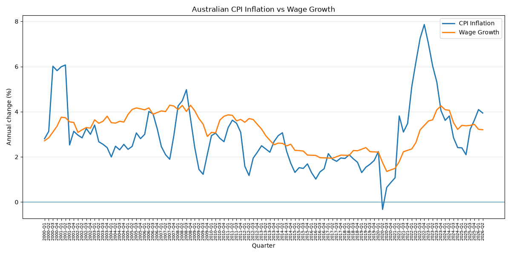

# AUS CPI-WPI

Analysis of Australian economic data using Consumer Price Index (CPI) and Wage Price Index (WPI) datasets from the Australian Bureau of Statistics (ABS).

The project retrieves CPI and WPI data from the ABS Data API, stores the data in MySQL, and uses Python to analyse and visualise inflation and wage growth over time.

## Features

- Retrieves CPI and WPI data from the ABS Data API
- Stores imported data in MySQL
- Calculates year-on-year CPI and WPI growth
- Compares inflation with wage growth
- Visualises trends using Matplotlib
- Supports analysis of real wage growth

## Technologies

- Python
- MySQL
- Pandas
- SQLAlchemy
- Requests
- Matplotlib

## Data Source

Data is sourced from the **Australian Bureau of Statistics (ABS)**.

The project uses CPI and WPI datasets made available through the ABS Data API.

## Screenshot

### CPI vs WPI



The chart compares year-on-year CPI inflation with year-on-year wage growth, making it easier to identify periods when wages grew faster or slower than consumer prices.

## Setup

### 1. Create the database

Create the MySQL database schema by running:

```text
sql_schema/schema.sql
```

### 2. Configure the database connection

Update the MySQL database connection settings in:

```text
constants.py
```

### 3. Import the data

Retrieve the CPI and WPI data from the ABS API and load it into the database:

```bash
python load_data_from_api.py
```

### 4. Run the application

```bash
python main.py
```

## Analysis

Year-on-year growth is calculated using:

```text
(Current Index / Index from Same Quarter Previous Year - 1) × 100
```

This is used to compare CPI inflation with WPI wage growth and identify periods where wages grew faster or slower than consumer prices.
